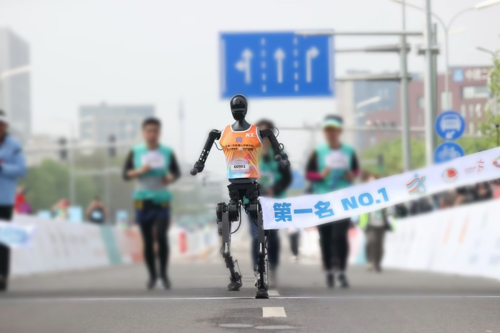

# TienKung-Lab

[](https://docs.omniverse.nvidia.com/isaacsim/latest/overview.html)
[](https://isaac-sim.github.io/IsaacLab)
[](https://github.com/leggedrobotics/rsl_rl)
[](https://docs.python.org/3/whatsnew/3.10.html)
[](https://opensource.org/licenses/BSD-3-Clause)

Isaac Lab 上的天工人形机器人运动控制：AMP + 周期步态奖励，支持 walk/run、Sim2Sim（MuJoCo）和实机部署。

<div align="center">
  
</div>

| Walk | Run |
| :--: | :-: |
|  |  |

## Tasks

| Task | Robot |
| --- | --- |
| `lite_walk` / `lite_run` | 天工2 Lite |
| `pro_walk` / `pro_run` | 天工2 Pro |
| `tienkung3_walk` / `tienkung3_run` | TienKung3 |

## Installation

Isaac Sim 4.5.0 + Isaac Lab 2.1.0（建议 conda，见 [Isaac Lab 安装](https://isaac-sim.github.io/IsaacLab/main/source/setup/installation/index.html)）。本仓库需放在 `IsaacLab` 目录外。

```bash
pip install -e .
pip install -e ./rsl_rl
python legged_lab/scripts/train.py --task=tienkung3_walk --logger=tensorboard --headless --num_envs=64
```

## Usage

### 天工2 Lite

```bash
# 训练
python legged_lab/scripts/train.py --task=lite_walk --headless --logger=tensorboard --num_envs=4096

# 回放
python legged_lab/scripts/play.py --task=lite_walk --num_envs=1

# AMP 动作可视化
python legged_lab/scripts/play_amp_animation.py --task=lite_walk --num_envs=1
```

跑步任务将 `lite_walk` 替换为 `lite_run`。

### 天工2 Pro

```bash
# 训练
python legged_lab/scripts/train.py --task=pro_walk --headless --logger=tensorboard --num_envs=4096

# 回放
python legged_lab/scripts/play.py --task=pro_walk --num_envs=1

# AMP 动作可视化
python legged_lab/scripts/play_amp_animation.py --task=pro_walk --num_envs=1
```

跑步任务将 `pro_walk` 替换为 `pro_run`。

### 天工3

```bash
# 训练
python legged_lab/scripts/train.py --task=tienkung3_walk --headless --logger=tensorboard --num_envs=4096

# 回放
python legged_lab/scripts/play.py --task=tienkung3_walk --num_envs=1

# AMP 动作可视化
python legged_lab/scripts/play_amp_animation.py --task=tienkung3_walk --num_envs=1
```

跑步任务将 `tienkung3_walk` 替换为 `tienkung3_run`。

### Sim2Sim（MuJoCo）

`sim2sim.py` 的 `--task` 仅接受 `walk` / `run`，用于选择步态参数。通过 `--model` 和 `--policy` 指定匹配的 MuJoCo 模型与导出策略：

```bash
python legged_lab/scripts/sim2sim.py --task walk --model <robot.xml> --policy <policy.pt> --duration 100
```

当前控制器固定为 23 个动作，关节映射、默认姿态和控制参数需与所选机器人及训练配置核对适配。

`play` 会把策略导出到 `logs/<task>/<timestamp>/exported/policy.pt`。预训练权重在 `Exported_policy/`。

## Motion Retargeting

用 [GMR](https://github.com/YanjieZe/GMR) 将 SMPLX（AMASS / OMOMO）转到机器人：

```bash
python scripts/smplx_to_robot.py --smplx_file <smplx.pkl> --robot tienkung --save_path <robot.pkl>
python legged_lab/scripts/gmr_data_conversion.py --input_pkl <robot.pkl> \
  --output_txt legged_lab/envs/tienkung3/datasets/motion_visualization/motion.txt
python legged_lab/scripts/play_amp_animation.py --task=tienkung3_walk --num_envs=1 \
  --save_path legged_lab/envs/tienkung3/datasets/motion_amp_expert/motion.txt --fps 30.0
```

- `motion_visualization/`：回放检查（root + dof 位姿/速度）
- `motion_amp_expert/`：训练 AMP 专家数据（dof + end-effector）

转换后把 config 里的 `amp_motion_files_display` / `amp_motion_files` 指到对应文件。

## Sim2Real

已在真机验证。部署见 [Deploy_Tienkung](https://github.com/Open-X-Humanoid/Deploy_Tienkung.git)。实机有风险，务必确认急停可用。

<p align="center">
  
</p>

## Acknowledgements

[GMR](https://github.com/YanjieZe/GMR) · [Legged Lab](https://github.com/Hellod035/LeggedLab) · [RSL RL](https://github.com/leggedrobotics/rsl_rl) · [AMP_for_hardware](https://github.com/Alescontrela/AMP_for_hardware) · [Humanoid-Gym](https://github.com/roboterax/humanoid-gym)
